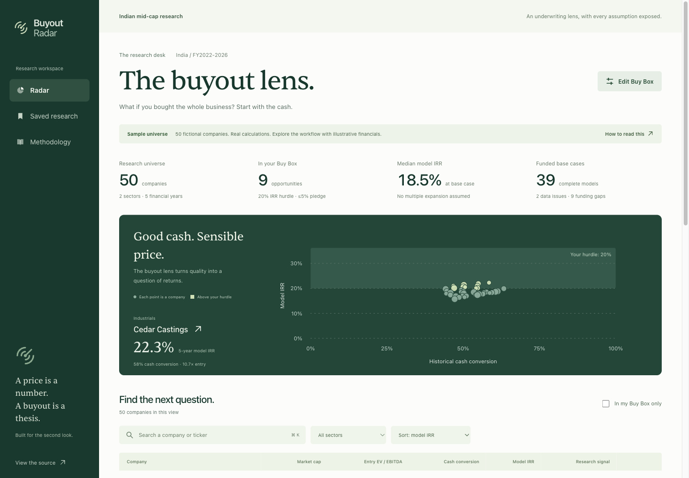

# Buyout Radar

[Open the live workspace](https://buyout-radar.vercel.app) · [Release verification](docs/release-1.0.md) · [Design audit](docs/design-audit.md)

An Indian mid-cap buyout research workspace with a dependency-free TypeScript finance engine, Groq evidence pipeline, Supabase provenance store and formula-driven Excel export.

**The model universe is fictional.** Its 50 companies demonstrate the full workflow. The [official filing pilot](https://buyout-radar.vercel.app/pilot) adds Shanthi Gears, RACL Geartech and Mayur Uniquoters with five-year source-checked standalone revenue/PAT histories. Pilot transaction returns remain unavailable while full underwriting inputs and independent review are pending. No live share price or real-world extraction accuracy is claimed. See [pilot release](docs/analyst-pilot-release.md) and [Methodology](docs/methodology.md).

## Run

Node 22 or newer (Node 24 recommended), npm 11+.

```sh
npm ci
npm run dev
```

Open http://localhost:3000. No credentials required in demo mode.

```sh
npm run typecheck
npm test
npm run eval
npm run verify:pilot -- --download
npm run build
npm run test:e2e
```

Playwright needs `npx playwright install chromium` once. Tests use a local production server on port 3100.

## Workspace

- `apps/web`: Next.js research UI, public read-only model/export APIs, source inspection.
- `packages/engine`: Pure finance functions, no web, database or AI dependencies.
- `packages/excel`: Eight-sheet Excel model with editable assumptions and provenance.
- `pipeline/ingest`: Explicit filing manifests, XBRL parser, validation, atomic writer.
- `pipeline/ai`: Groq dual extraction, quote checks, judging, cache and review routing.
- `pipeline/eval`: Synthetic verifier fixtures and a reusable precision/recall scorer.
- `db/migrations`: Ordered PostgreSQL schema, RLS and service-only ingestion RPC.

## Preview



## Features

Radar ranking, search, sector filters, saved research and editable Buy Box. Company histories, quality of earnings, working capital, debt capacity, stress case, live five-year LBO, return attribution, two sensitivity grids, hurdle solver, promoter lens, rule-based bear case, private notes, scenario links and Excel export.

## Research workflow tools

Compare two to four companies from Radar or Saved Research, save named screens, and export every filtered row to CSV. Company workspaces now include a named scenario library with base-versus-saved comparisons, an editable diligence checklist, research stages, next actions and printable private memos.

Saved Research filters by stage and upcoming or overdue actions. Its **Backup & restore** tool exports all browser-local research, previews import conflicts and lets you keep existing records or replace them explicitly. Unsaving a company preserves its notes and workflow. No login or new credentials are needed.

See [workflow guide](docs/research-workflow.md) for storage, import and printing details.

## Connect Supabase

Apply `db/migrations/*.sql` in order to a dedicated project. Configure server environment variables `DATA_MODE=supabase`, `SUPABASE_URL`, `SUPABASE_ANON_KEY`. Public reads use a publishable key. Administrative ingestion requires `SUPABASE_SERVICE_ROLE_KEY` only in the local pipeline environment. Never expose that key to the web client.

Generate clearly marked sample seed SQL with `npx tsx pipeline/seed.ts`. Each file calls an atomic RPC. Seed only the dedicated project. Existing company IDs make repeated seeding idempotent.

## Use Groq

Set `GROQ_API_KEY` in your local environment. Defaults are `openai/gpt-oss-20b` and `openai/gpt-oss-120b` at `https://api.groq.com/openai/v1`. Check Groq model availability before large runs. `EXTRACTOR_A_*` and `EXTRACTOR_B_*` override the endpoints and models.

```sh
npm run pipeline -- extract /absolute/path/to/report.pdf
npm run pipeline -- validate /absolute/path/to/manifest.json
npm run pipeline -- ingest /absolute/path/to/manifest.json
npm run pipeline -- ingest /absolute/path/to/manifest.json --write --publish
```

Extraction is never triggered by an anonymous website visitor. The app does not have or require a public AI endpoint. See [Pipeline runbook](docs/pipeline.md), [deployment](docs/deployment.md), and [scope status](docs/scope-status.md).

## Analyst workflow and official filing pilot

A decision brief surfaces coverage, funding gaps, stress results and evidence status. Screening and scenario hurdles are explained independently. Sources use financial labels and grouped evidence, with direct navigation to private notes and diligence. Saved Research summarizes the analyst's saved workload. The map supports exact selection and expanded axes with readable mobile plots.

The official filing pilot records 30 reported revenue/PAT observations across seven original company PDFs. Source inspection exposes original units, PDF/printed pages, checked dates and SHA-256 fingerprints. Save a pilot company, track diligence, write notes, export sourced facts or print a private memo. Pilot research participates in the existing backup and restore system. Read the [release and verification notes](docs/analyst-pilot-release.md).

## Product boundaries

No real 500-company database, manually verified LBO, 20-company human answer key, customer outreach or market-data license is claimed. V2 comparable deals, alerts, SEC filings and dedicated PDF one-pagers remain roadmap. Browser-printable private research memos are available. Financial assumptions are research scenarios. Notes are local to one browser; no multi-user authentication is implied.

## License

Code: MIT. Sentient font files retain their ITF Free Font License. See `apps/web/public/fonts/README.md`.
