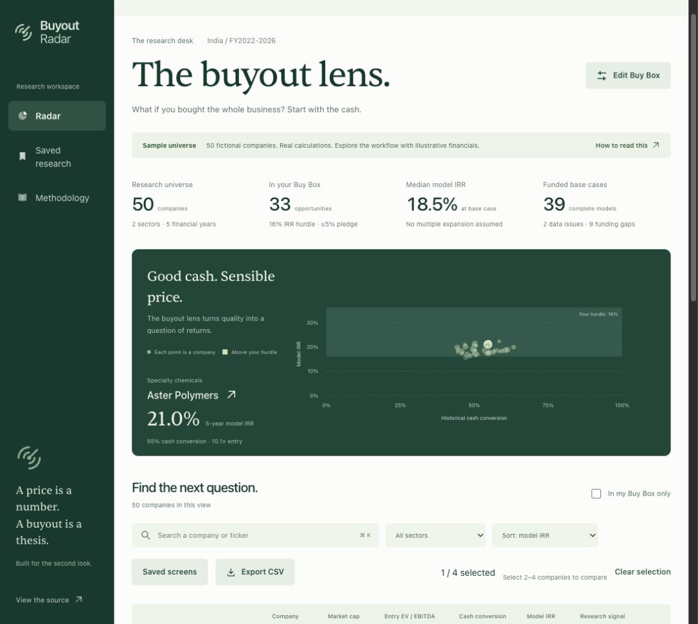
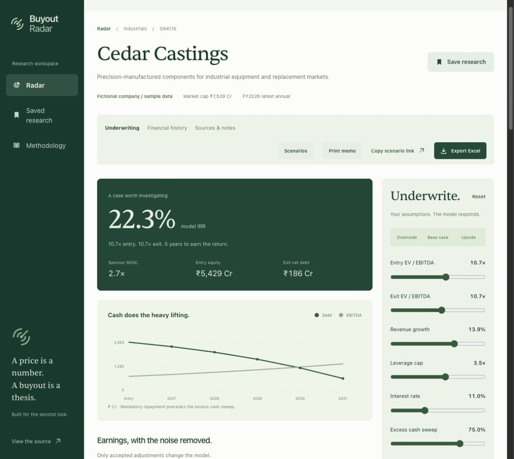
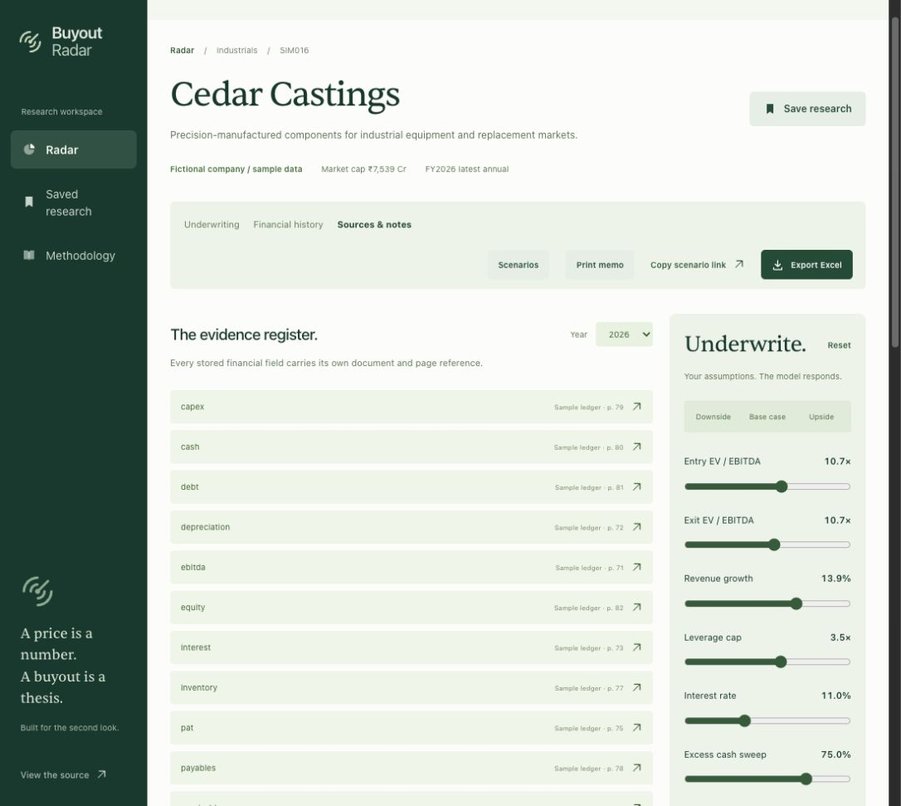
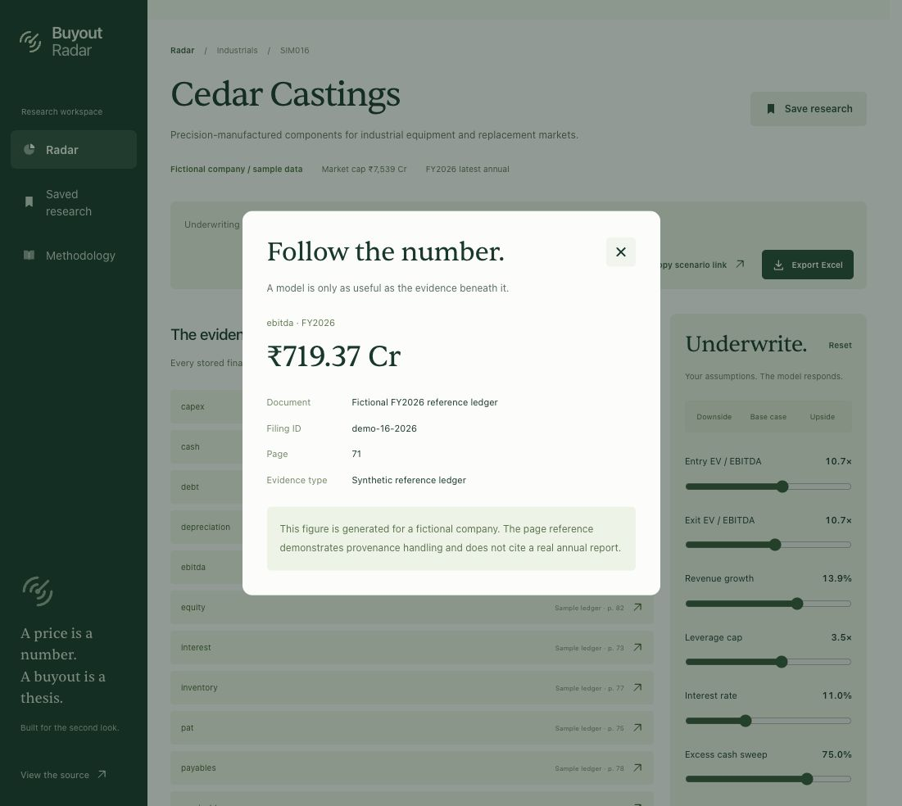
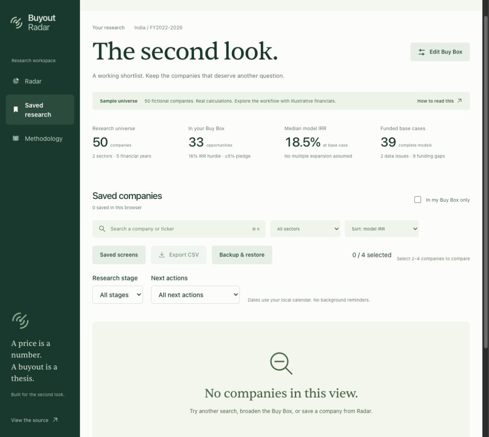

# Buyout Radar: investor readiness review

Reviewed 28 October 2026 against production commit 8a5206c. Intended audience: buyout investors and acquisition analysts.

## Verdict

The browser-local implementation is appropriate for the ten-feature plan. All ten features have implementation and existing browser/unit coverage. This review inspected the source and test coverage, and visited the live flows below. It did not rerun the complete regression suite or independently validate the financial model.

The application is a credible working demonstration. Investor readiness requires a verified research pilot, independent model review, and evidence that analysts return to use it. Deployment success and passing software tests do not establish these outcomes.

## Current capture evidence

1. Radar: working research universe and a coherent map/table composition. The fictional data disclosure is prominent. Points cluster tightly in the map, limiting visual discrimination at this viewport. The browser's saved Buy Box hurdle is 16%.

2. Company underwriting: populated model, editable assumptions and visible fictional-data label. The current company model uses a 20% hurdle independently of the saved Buy Box. This is a context gap, not a calculation error. A decision summary should surface downside coverage, key evidence gaps and assumptions beside the headline return.

3. Sources and notes: field-specific provenance navigation exists. The visible register uses raw keys such as ebitda and taxPaid, and long evidence rows push the analyst's notes and next action below the initial viewport. Financial labels should be readable, and diligence should be directly accessible.

4. Evidence inspection: opening EBITDA shows amount, document, filing ID, year and page. The dialog honestly says the ledger is fictional. This is good disclosure, but the release has no verified real-company evidence with which to establish decision value. The close control worked. No independent keyboard or screen-reader certification is implied.

5. Saved Research: stage, action filters and backup controls are available. The zero-saved state still headlines 50 universe companies and 33 opportunities. Those values are correctly labeled as universe statistics, but take priority over the user's actual workload. Backup dialog opens and discloses private-note inclusion; this audit did not import, delete or modify existing research.

## Ten-feature traceability

| Feature             | Implementation                       | Existing regression evidence                             |
| ------------------- | ------------------------------------ | -------------------------------------------------------- |
| Company comparison  | compare route, Radar selection       | comparison cap and invalid query test                    |
| Saved screens       | screen manager                       | save, rename, load, delete and reload test               |
| CSV export          | research-export library              | all-result download and escaping tests                   |
| Scenario library    | scenario-library component           | save, rename, load, delete test                          |
| Scenario comparison | scenario-library table               | limits and unavailable-return gates                      |
| Diligence checklist | company-workflow component           | task CRUD and persistence test                           |
| Research stages     | company-workflow, Radar filters      | stage persistence/filter test                            |
| Next actions        | company-workflow, Radar filters      | dated action and filtering test                          |
| Printable memo      | printable-memo component             | memo content and withheld return test                    |
| Backup/restore      | research-backup, workflow validation | conflicts, round trip, invalid imports and failure tests |

Sources: apps/web/components, apps/web/lib/workflow.ts, tests/e2e/workflow.spec.ts, tests/workflow.test.ts and tests/storage.test.ts. Existing release verification reported 58 unit tests and 15 browser tests passing. Those counts are historical release evidence, not tests newly executed by this audit.

## Recommended next release

### A. Improve the existing analyst workflow

- Keep the existing forest palette, self-hosted typography, useful bare icons and opportunity map.
- Explain the relationship between the screening hurdle and the scenario hurdle adjacent to both values. Preserve explicit scenario-link and saved-scenario assumptions. Do not silently rewrite financial assumptions.
- Replace raw evidence keys with financial labels, grouped into earnings, cash flow, balance sheet and ownership when supported by actual stored fields. Add direct navigation to notes and diligence.
- Give Saved Research summaries of saved companies, stages and dated next actions. Give its empty state a direct route to Radar. Keep whole-universe metrics on Radar.
- Add a concise company decision summary using existing computed results: returns, minimum coverage, funding gap, stress breach and evidence completeness. Withhold confident returns for incomplete or unfunded cases.
- Improve map point selection where companies overlap, using keyboard-accessible selection and the existing table as the precise alternative. Do not distort data positions without disclosure.
- Increase the readability of small chart labels and metadata. Measure contrast and reflow rather than asserting compliance from screenshots.

Acceptance: relevant values agree with the current scenario; explicit assumptions survive navigation; notes and diligence are reachable without traversing the entire evidence register; Saved Research counts reconcile to saved records; all new controls work with keyboard and pointer; mobile tables stay contained; no content depends on entrance animation.

### B. Publish a small verified pilot

Start with three to five real companies and five annual periods where available. Obtain permitted official filings and identify reporting basis, units, fiscal dates, price/valuation dates and document versions. Record source pages and reviewer decisions. Reconcile normalized earnings, working capital, cash, debt and the Excel model independently before publication. Present unknowns as unknowns.

Add a compact evidence-status view: period covered, source availability, review status and unresolved questions. Date the market inputs separately from annual financials. Document control feasibility, financing and ownership as diligence questions unless independently established.

Acceptance: every material input can be traced to a source or is explicitly an assumption; the model reconciles to an independently reviewed workbook; unresolved evidence suppresses confident conclusions; no synthetic record is relabeled as real. Filing access, reuse rights and human review are required inputs. Software alone cannot supply independent verification.

### C. Measure qualified use

The application source contains no product analytics instrumentation found in this audit. Hosting analytics may exist separately; no actual audience-quality conclusion can be made from source code or screenshots.

Measure an anonymous funnel: visit -> company opened -> evidence opened -> scenario changed -> research saved -> export/memo used -> return visit. Segment by permitted referral/campaign metadata and supplement with optional role feedback. Do not capture private notes, checklist text, next-action text or backup contents.

Use completion and return behavior to set a baseline before promising conversion or retention targets. An export alone does not prove investor intent. Ask a small pilot group to perform a real screening task and observe whether they can reach a defensible pass/fail question faster.

Account synchronization, collaboration and durable version history are possible later architectural additions. The original plan explicitly chose browser-local research, so their absence is a scope decision. Pilot evidence should decide whether to expand that scope.

## Design-law recheck and limits

Reconsidered the supplied law across its typography, palette, template-layout, icon, decoration, shadow/glass, motion, clipping, spacing, centering, comparison-alignment, accessibility, truthful-content and functional-control requirements. The current captured screens preserve one visual system and show genuine working financial artifacts. A new marketing hero or decorative layer would not improve this analyst task.

The small metadata and chart labels warrant measured contrast/size checks. Map overlap, raw financial field labels, workload hierarchy and hurdle context are the concrete shortcomings identified here. No new interface was shipped during this review; this brief describes the proposed changes. The screenshots do not establish whole-site compliance, mobile behavior, reduced motion, print alignment or complete keyboard operation. Those require fresh checks after implementation. Earlier design-audit results remain historical evidence only.

All five screenshots were captured from the live production browser during this review, saved locally and inspected. No production records or private research were changed.
